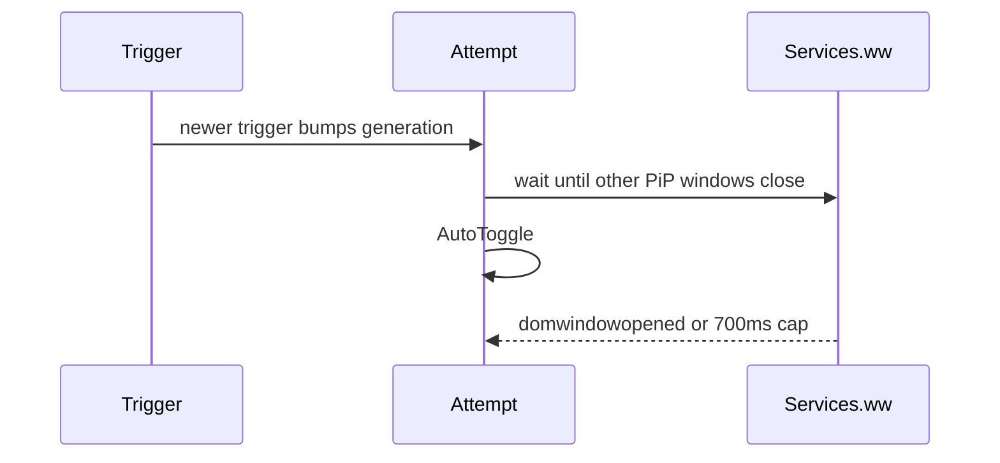

# Auto-PiP (tab switch & Space)

**Status:** shipped

## Goal

When the playing video is no longer what the user is looking at, open Zen’s
Picture-in-Picture automatically — Arc-like — without firing on transient
overlays (Raycast, Spotlight, menu bar).

## Triggers

1. **Tab switch** — leave a tab that had a playing, unmuted, PiP-eligible video
2. **Window deactivate** — another Space / Stage Manager / other app (not an
   overlay bundle ID)
3. **Occlusion / minimize** — when the platform reports the window not visible

Pref: `zen.pip.autoSpace.enabled` (default `true`).

## Implementation notes

Auto-PiP sends `PictureInPicture:AutoToggle` to the content
`PictureInPictureLauncher` actor. Firefox only opens PiP when the child finds a
video that is **playing**, **not muted**, and **PiP-eligible**.

### Do not force `docShellIsActive = false` before AutoToggle

Especially on deactivate, forcing the docShell inactive can pause media before
`autoToggle()` runs its `videoIsPlaying` check, which yields a silent no-op
(`no-pip` in `~/Library/Logs/zen-pip-scripts.log`).

### Close PiP through Firefox’s maps

Raw `win.close()` on a PiP player does **not** clear `browserWeakMap` /
`weakAutoPipBrowserToParent`. Later AutoToggle attempts then hit
`skip-already-pip` forever. Always remove those entries (prefer
`PictureInPicture.closeSinglePipWindow` with reason `Unpip`) before closing.

## One attempt, wake on the PiP window

Each browser window has a single in-flight Auto-PiP attempt. A newer trigger
(another tab switch, deactivate, or occlusion) bumps a generation token and
cancels the previous wait. `unpip` of a different browser does not cancel an
attempt that is already running for the tab that was left.

Waits follow the window, with a deadline so a missing signal cannot hang:

| Wait | Signal | Cap |
| ---- | ------ | --- |
| Other PiP windows closed before `AutoToggle` | `domwindowclosed` until no `Toolkit:PictureInPicture` window remains | 200ms |
| PiP opened after `AutoToggle` | `domwindowopened` for a `Toolkit:PictureInPicture` window | 700ms |

If the first open wait hits the cap with no PiP window, Auto-PiP sends
`AutoToggle` once more and waits again. The frontmost bundle id is read once
per deactivate. The log file stays open for the session (one output stream).

## Logging

`autofocus …` lines in `~/Library/Logs/zen-pip-scripts.log`. The script keeps
one append stream open for the session instead of opening and closing the file
on every decision.
