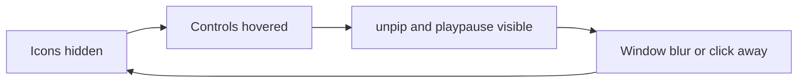
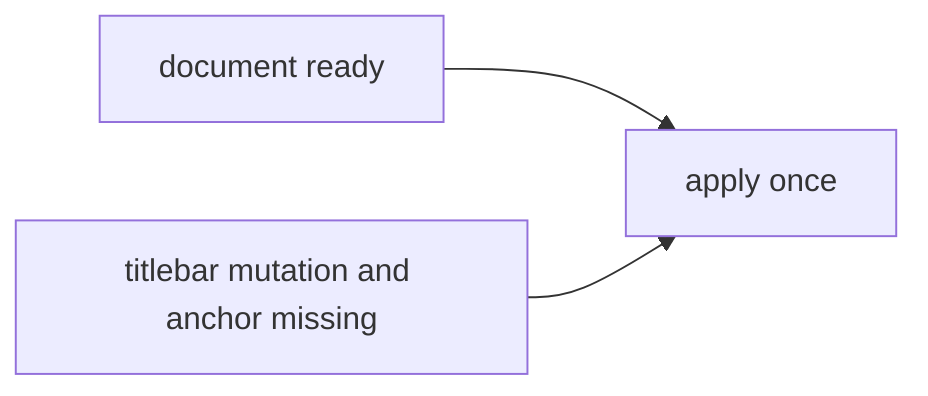

# PiP player controls overlay

**Status:** shipped

## Goal

In Zen’s Picture-in-Picture window
(`chrome://global/content/pictureinpicture/player.xhtml`), keep a minimal
overlay: top-left Back-to-Tab (`#unpip`) and bottom-left play/pause
(`#playpause`). Both icons scale with the PiP window via `8cqi`, capped at
48px. They stay hidden until the pointer is over the controls. Clicking out of
the PiP hides them as well. Hide close, minimize, the bottom gradient, scrubber,
seek, volume, and captions.

## Hide

| Selector | Role |
| -------- | ---- |
| `#close` | In-player close |
| `#minimize` | In-player minimize |
| `#controls-bottom-gradient` | Fade behind the bottom row |
| `.controls-bottom-upper` | Seek scrubber row |
| `.start-controls` / `.end-controls` | Timestamp / volume / captions cluster |
| `#seekBackward` / `#seekForward` | Skip buttons beside play/pause |

Do **not** hide the whole `#controls-bottom` — `#playpause` lives inside it.
Each hidden node uses `display: none !important`.

## Hover and click-away

`#unpip` and `#playpause` start at `opacity: 0` with `pointer-events: none`.
While the window is active they show when `#controls` is hovered, `showing`, or
`keying`. `:-moz-window-inactive` and the `pip-inactive` attribute (set on
window blur) keep both icons hidden.

## Back-to-Tab (`#unpip`) and play/pause (`#playpause`)

| Concern | Rule |
| ------- | ---- |
| `#unpip` | Top-left, `left` / `top` in `cqi`, `right: auto` |
| `#playpause` | Bottom-left, `left` / `bottom` in `cqi` |
| Size | `8cqi`, `max-width` / `max-height` 48px |
| Background | Transparent `background-color` only (keep the SVG `background-image`) |
| Icon | White fill / color (`#ffffff`, `fill-opacity: 1`) |
| Depth | `drop-shadow(0 2px 4px rgba(0, 0, 0, 0.75))`; stronger on hover/focus |

## Sources of truth

| File | Role |
| ---- | ---- |
| `chrome/CSS/zen-pip-no-traffic-lights.uc.css` | **Primary** — fx-autoconfig author sheet (`@include` player.xhtml). Bypasses PiP CSP. |
| `chrome/CSS/zen-pip-no-traffic-lights.css` | Mirror for docs/tests / embed sync (not loaded by fx-autoconfig; only `*.uc.css` is) |
| `chrome/JS/zen-pip-no-traffic-lights.uc.js` | Cocoa buttonbox hide + `windowUtils.loadSheetUsingURI` backup for `INLINE_CSS` |

### Why not a DOM `<style>` tag?

`player.xhtml` ships `Content-Security-Policy: default-src chrome:`. An inline
`<style>` appended by UC.js is ignored, which is why close / minimize / the
bottom bar kept showing after a plain file copy. Author sheets loaded through
fx-autoconfig (or `loadSheetUsingURI`) are not subject to that CSP.

### PiP-only — never main Zen

- `.uc.css` header must end with `==/UserScript==*/`. An unclosed
  `/* ==UserScript==` header drops `@include` and fx-autoconfig falls back to
  **browser.xhtml**, which can hide titlebars / break the main window.
- Every selector is gated with
  `html[windowtype="Toolkit:PictureInPicture"]`.
- UC.js injects with `AUTHOR_SHEET` only (not `AGENT_SHEET`).
- Deploy by copying profile `chrome/` files; **do not** quit Zen or run the
  full installer just to refresh PiP CSS — close and reopen the PiP window.

Do **not** set `background:` shorthand or `background-image: none` on `#unpip`
or `#playpause` — the glyphs are `background-image` SVGs; only clear
`background-color`.

`./scripts/validate` rsyncs `chrome/` into `internal/assets/chrome/` for the
installer embed.

Pref gate for the script remains `zen.pip.hideTrafficLights.enabled`
(default `true`).

## Apply lifecycle

`zen-pip-no-traffic-lights.uc.js` applies once when the PiP document is ready.
It does not dispatch a `resize` event, and it does not listen for `resize` to
call `apply` again. That loop kept every open PiP window busy. A
`MutationObserver` on `#titlebar` reapplies only when
`#zen-pip-buttonbox-anchor` has been removed. `fullscreenchange` applies once,
because fullscreen can rebuild the titlebar. There is no 0 / 100 / 400 / 1000
ms timer ladder.

