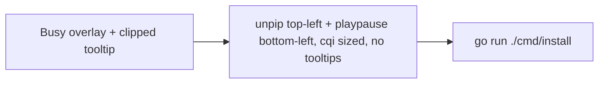

# PiP player controls overlay

**Status:** shipped

## Goal

In Zen’s Picture-in-Picture window
(`chrome://global/content/pictureinpicture/player.xhtml`), keep a minimal
overlay: top-left Back-to-Tab (`#unpip`) and bottom-left play/pause
(`#playpause`). Both icons scale with the PiP window via CSS container query
units. Hide close, minimize, the bottom gradient, scrubber, seek, volume, and
captions. Suppress the clipped CSS tooltips on control buttons.

## Hide

| Selector | Role |
| -------- | ---- |
| `#close` | In-player close |
| `#minimize` | In-player minimize |
| `#controls-bottom-gradient` | Fade behind the bottom row |
| `.controls-bottom-upper` | Seek scrubber row |
| `.start-controls` / `.end-controls` | Timestamp / volume / captions cluster |
| `#seekBackward` / `#seekForward` | Skip buttons beside play/pause |

Do **not** hide the whole `#controls-bottom` — `#playpause` lives inside it.
Each hidden node uses `display: none !important`.

## Tooltips

Firefox PiP draws hover labels with `.control-item:hover::after { content: attr(tooltip); }`.
Those labels clip at the window edge (e.g. “ck to tab”). Overlay CSS forces
`content: none` / `display: none` on control `::after` tooltips.

## Container sizing

`#controls` is a size query container (`container-type: size`). `#unpip` and
`#playpause` use `cqi` for width, height, and corner inset so they track the
PiP window size ([CSS `container`](https://developer.mozilla.org/en-US/docs/Web/CSS/Reference/Properties/container)).

## Back-to-Tab (`#unpip`)

| Concern | Rule |
| ------- | ---- |
| Position | Top-left via `cqi` insets; `right: auto` (overrides macOS `#unpip[mac="true"]`) |
| Size | `width` / `height` in `cqi` (no fixed 16–32px clamp) |
| Background | Transparent `background-color` only (keep SVG `background-image`) |
| Icon | White fill / color (`#ffffff`, `fill-opacity: 1`) |
| Depth | `filter: drop-shadow(0 2px 4px rgba(0, 0, 0, 0.75))`; elevated on hover/focus |
| SVG fill | `-moz-context-properties: fill, fill-opacity` |

## Play / pause (`#playpause`)

| Concern | Rule |
| ------- | ---- |
| Position | Bottom-left via `cqi` insets (same inset/size language as `#unpip`) |
| Toggle | Stock Firefox class on `#controls` (`.playing`) swaps play/pause glyphs |
| Chrome | Transparent pill; white icon; same drop-shadow family as `#unpip` |

## Deploy

Ship overlay changes through the installer embed (`./scripts/validate` →
`go run ./cmd/install`). Do not rely on ad-hoc profile file copies for feature
delivery — the Update path in the README is the supported way to install new
chrome on the machine.

## Sources of truth

| File | Role |
| ---- | ---- |
| `chrome/CSS/zen-pip-no-traffic-lights.uc.css` | **Primary** — fx-autoconfig author sheet (`@include` player.xhtml). Bypasses PiP CSP. |
| `chrome/CSS/zen-pip-no-traffic-lights.css` | Mirror for docs/tests / embed sync (not loaded by fx-autoconfig; only `*.uc.css` is) |
| `chrome/JS/zen-pip-no-traffic-lights.uc.js` | Cocoa buttonbox hide + `windowUtils.loadSheetUsingURI` backup for `INLINE_CSS` |

### Why not a DOM `<style>` tag?

`player.xhtml` ships `Content-Security-Policy: default-src chrome:`. An inline
`<style>` appended by UC.js is ignored. Author sheets loaded through
fx-autoconfig (or `loadSheetUsingURI`) are not subject to that CSP.

### PiP-only — never main Zen

- `.uc.css` header must end with `==/UserScript==*/`. An unclosed
  `/* ==UserScript==` header drops `@include` and fx-autoconfig falls back to
  **browser.xhtml**, which can hide titlebars / break the main window.
- Every selector is gated with
  `html[windowtype="Toolkit:PictureInPicture"]`.
- UC.js injects with `AUTHOR_SHEET` only (not `AGENT_SHEET`).

Do **not** set `background:` shorthand or `background-image: none` on `#unpip`
or `#playpause` — the glyphs are `background-image` SVGs; only clear
`background-color`.

`./scripts/validate` rsyncs `chrome/` into `internal/assets/chrome/` for the
installer embed.

Pref gate for the script remains `zen.pip.hideTrafficLights.enabled`
(default `true`).
