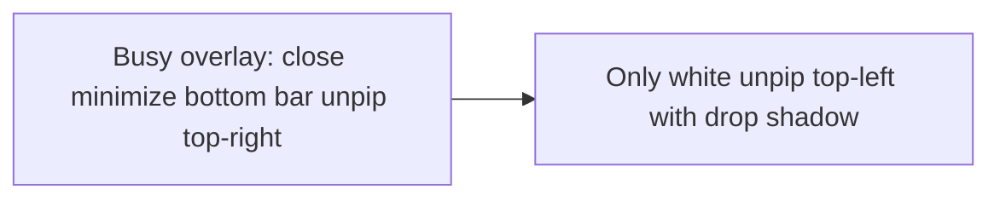

# PiP player controls overlay

**Status:** shipped

## Goal

In Zen’s Picture-in-Picture window
(`chrome://global/content/pictureinpicture/player.xhtml`), show only the
Back-to-Tab control (`#unpip`) as a standalone white icon with a drop shadow in
the top-left corner. Hide close, minimize, and the entire bottom transport
overlay so the video stays uncluttered.

## Hide

These nodes are never shown while the traffic-lights / controls companion CSS is
active:

| Selector | Role |
| -------- | ---- |
| `#close` | In-player close |
| `#minimize` | In-player minimize |
| `#controls-bottom` | Seek + play/pause + volume row |
| `#controls-bottom-gradient` | Fade behind the bottom row |

Each uses `display: none !important`.

## Back-to-Tab (`#unpip`)

| Concern | Rule |
| ------- | ---- |
| Position | `left: 10px`, `right: auto`, `top: 10px` (overrides macOS `#unpip[mac="true"]`) |
| Background | Transparent (no light square chrome) |
| Icon | White fill / color (`#ffffff`, `fill-opacity: 1`) |
| Depth | `filter: drop-shadow(0 2px 4px rgba(0, 0, 0, 0.75))`; elevated shadow on hover/focus |
| SVG fill | `-moz-context-properties: fill, fill-opacity` so white fill applies to the icon |

## Sources of truth

| File | Role |
| ---- | ---- |
| `chrome/CSS/zen-pip-no-traffic-lights.css` | Companion stylesheet |
| `chrome/JS/zen-pip-no-traffic-lights.uc.js` | `INLINE_CSS` injected into the PiP document (PiP has no `userChrome.css`) |

`./scripts/validate` rsyncs `chrome/` into `internal/assets/chrome/` for the
installer embed.

Pref gate for the script remains `zen.pip.hideTrafficLights.enabled`
(default `true`).
