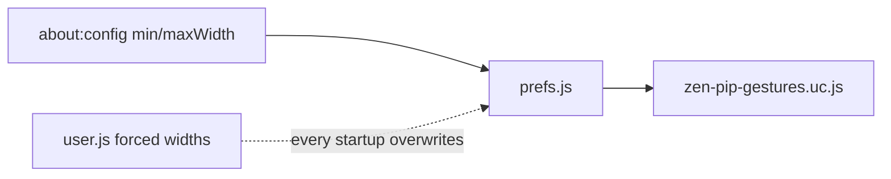

# Prefs (`user.js` vs about:config)

**Status:** shipped

## Two stores

Firefox / Zen apply prefs from two places:

| Store | When applied | Role here |
| ----- | ------------ | --------- |
| Profile `user.js` | Every startup (overwrites matching keys in `prefs.js`) | Installer feature toggles only |
| Profile `prefs.js` / `about:config` | Session + quit save | Custom values that must survive reopen |

Feature bools (`zen.pip.gestures.pan.enabled`, pinch, autoSpace, hideTrafficLights, onlyOne, master trackpad) are written by `WriteUserPrefs` into `user.js` so the installer’s choices stick.

## Size prefs must not live in `user.js`

`zen.pip.gestures.minWidth` and `zen.pip.gestures.maxWidth` are read by the PiP gesture script with in-code defaults (`200` / `900`). Users change them in `about:config`. Those keys must **not** be forced from `user.js`, or every quit/reopen resets them to the `user.js` values.

Older installs left default width lines in `user.js`. `WriteUserPrefs` strips those two keys when it rewrites the file so leftover lines stop wiping about:config.

